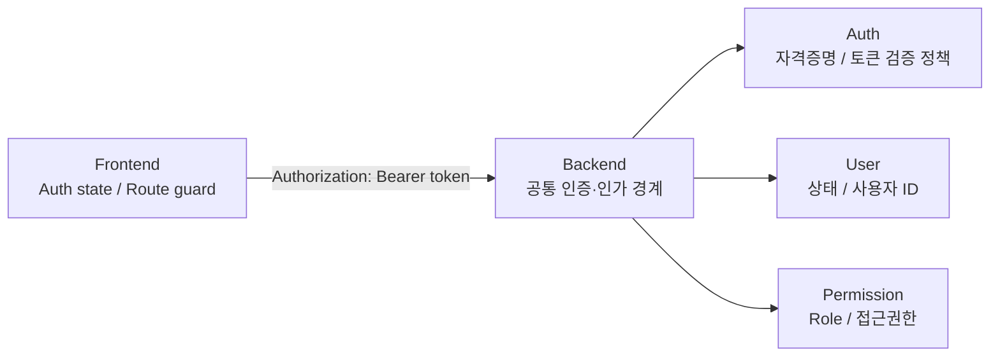

# 인증·인가 공통 설계 / Mock 연결 기준 (AA 초안)

상태: **Draft, 미결정 정책은 결정 기록으로 확정 필요**. A(Auth), B(User), C(Permission)의 독립 개발과 통합을 위한 공통 기준입니다. 이 문서는 API를 새로 확정하는 문서가 아니며, **승인된 `openapi.yaml`이 외부 계약의 유일한 정본**입니다.

## 현재 계약에서 확정된 사실
- `POST /auth/login`은 Guest 허용, 성공 시 `accessToken` + `tokenType` 반환 (`TokenResponse`). 토큰 유효기간·Role·사용자 ID는 이 응답에 정의되어 있지 않습니다.
- 전역 `security: bearerAuth` (HTTP Bearer, `bearerFormat: JWT`); 로그인·회원가입은 익명 허용.
- Role 코드 `USER`, `ADMIN`; 관리자 업무는 ADMIN 권한 필요. 미인증 401, 권한 부족 403, 오류 형식은 `ApiError {code, message}`를 기준으로 계획합니다.
- `GET /auth/me` 또는 `GET /users/me`의 역할 목록 반환은 **현재 계약에 없음**. 기존 `GET /users/me`는 User 프로필만 반환합니다.
- 모든 API에 401/403 응답이 명시된 것은 아니므로 **상태코드·응답 명세 보완은 Contract PR**로 결정합니다.

## FE/BE 경계

- FE: 공통 Auth 상태를 읽고 Guest/USER/ADMIN 화면 노출·가드·401/403 UX를 통일합니다. FE 가드는 보안 경계가 아닙니다.
- BE: 각 보호 API에서 토큰의 유효성/사용자/권한을 검증하며, 프론트 요청에 포함된 임의 Role/User ID를 신뢰하지 않습니다.
- Auth A: 토큰 발급/검증 책임과 공통 Principal 규격을 AA와 협의합니다.
- User B / Permission C: 공통 인증 결과를 소비합니다. **각자 JWT 파싱·검증 정책을 임의 정의하지 않습니다.**
- 모듈형 단일 앱/물리 MSA 및 토큰 키·서명/조회 방식에 따라 구현 경계는 바뀌므로 [DEC-003](./decisions.md)을 선결해야 합니다.

## 통합 전 최소 합의가 필요한 '인증 컨텍스트'
다음은 **내부 인터페이스 후보**이며 현재 확정된 JWT Claim 또는 API Response 형식이 아닙니다.

| 항목 | 의미 | 결정이 필요한 것 |
|---|---|---|
| currentUserId | 인증된 내부 User 식별자 | 토큰 claim? 내부 조회? 식별자 타입 |
| roleCodes | 실제로 허용된 Role 목록 | 토큰 claim? Permission 조회? 캐시/변경 반영 시점 |
| authenticated | 인증/만료 상태 | FE 재인증 동작, Refresh 정책 |
| accountStatus | ACTIVE / INACTIVE / WITHDRAWN | 로그인·기존 세션 허용/차단 시점 |

예: `GET /auth/me`를 추가해 `userId`·`roles`를 내려주는 방식은 **변경 제안 후보**입니다. 엔드포인트/스키마/응답 코드가 승인되기 전까지는 화면 또는 Backend 코드에서 이 API가 존재한다고 가정하지 않습니다.

## Mock 인증 원칙
- FE 개발 시 `Guest`, `USER`, `ADMIN`, `expired`, `inactive` 상태를 **명시적인 테스트 fixture**로 주입해 페이지를 분리 검증합니다.
- Mock API 응답은 **현재 고정 Contract SHA의 실제 Schema만** 흉내냅니다. 현재 Login 응답에 Role 필드 등을 임의 추가하지 않습니다.
- FE는 Auth 상태 공급자 인터페이스(구현명 미정)를 사용하고 Mock/Real Adapter를 교체합니다. Mock 시나리오 선택 UI는 개발/테스트 모드로 한정합니다.
- BE는 Test-only 인증 컨텍스트/토큰 발급 fixture를 **공식 Auth 검증 경로와 호환되는 방식으로** 구성합니다. 프로덕션 인증 우회 필터/고정 관리자 토큰은 금지합니다.
- Mock 활성화와 테스트 키·계정·비밀번호는 운영 빌드에 포함하지 않습니다. 공통 테스트 키는 소스에 커밋하지 않습니다.
- FE Mock 성공은 실제 로그인/권한 통합 성공으로 인정되지 않습니다.

## 합의해야 할 시점
1. **개발 전**: Principal/Role 해석 방법, `401/403`, 테스트 fixture 사용자 식별자, Mock 및 Real Adapter 경계 합의.
2. **병렬 개발 중**: Mock 화면/BE 단위 테스트는 승인 계약에 맞춰 독립 실행.
3. **통합 전**: A 토큰으로 B/C 보호 API 호출, USER/ADMIN 접근 차단, 가입→로그인, Role 변경 효과 등 실제 환경 검증.

관련 자료: [시나리오/검증](./integration-test-plan.md), [Mock 데이터 규약](./mock-fixtures.md), [미결정 기록](./decisions.md), [계약 변경 규칙](../contract-governance.md).
