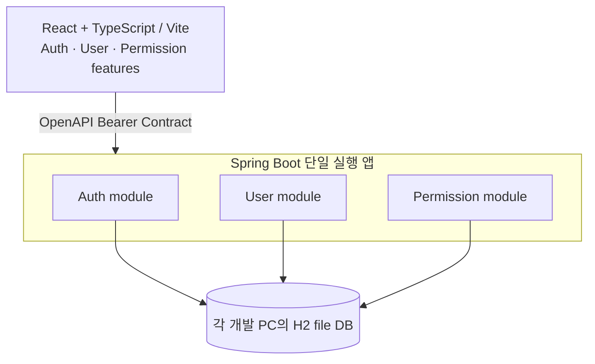

# PoC 기술 스택 제안서 (AA 검토용)

**상태: Proposed — 구현 확정/승인 아님.** 개발자가 임의로 서비스 분리·Token 정책을 확정하지 않도록 [설계 결정 기록](./decisions.md)의 DEC-003, DEC-004, DEC-011과 함께 검토합니다.

## 선택 배경과 추천 구조

공유 DB 서버가 없고 개발자 A=Auth FE+BE, B=User FE+BE, C=Permission FE+BE가 각각 기능을 개발하는 3인 SDD PoC. **물리 MSA 대신 단일 실행 Spring Boot Backend + 논리 분리 모듈(Auth/User/Permission) + 하나의 React 앱**을 제안합니다.

이 도식은 **개발/통합 환경의 제안**이며 배포 구조가 확정되었다는 뜻이 아닙니다. FE/BE의 API 요청·응답은 `openapi.yaml`과 `contract.sha`를 기준으로 합니다.

## 추천 라이브러리

| 영역 | 1차 권장 | 선택 이유/주의 |
|---|---|---|
| Backend 언어 | Java 21 LTS | 3인 팀의 공통 개발 기준 |
| Framework | Spring Boot 4.1.x(시작 시 최신 유지보수 Patch) + Spring Web MVC | 단일 배포형 REST API; Java 21 호환 |
| Auth | Spring Security + JWT, 공통 인증 경계 | 토큰 저장·발급/Role 반영 정책은 DEC-001/009 결론 필요 |
| Persistence | Spring Data JPA + Hibernate ORM | Hibernate는 DB가 아니라 ORM |
| Local DB | **H2 Embedded File** | 별도 서버 없이 재기동 뒤에도 데이터 유지. 각 PC별 로컬 DB |
| Automated Test DB | **H2 In-memory** | 테스트마다 격리·초기화, 테스트 간 데이터 공유 회피 |
| DB migration | Flyway + 버전별 SQL, JPA ddl-auto=validate | 테이블 변경을 Git/PR에서 검토 가능; schema.sql/data.sql 혼용 금지 |
| Backend build/test | Gradle Wrapper(Kotlin DSL), JUnit, MockMvc | 고정 Wrapper와 Java toolchain으로 재현성 확보 |
| Frontend | React + TypeScript + Vite | 단일 Frontend, 빠른 HMR/개발 |
| Routing/state | React Router + TanStack Query | 공통 보호 Route, 서버 상태/캐시 분리 |
| CSS | CSS Modules + `design.md` CSS Custom Properties | 도메인별 디자인 편차 억제, 스타일 명세 중복 방지 |
| Typed API | 기존 openapi-typescript 생성기 | 승인된 Contract SHA의 타입만 사용 |
| Frontend test | MSW + Vitest + Testing Library + Playwright | Mock 단위 검증→실제 Auth 연동 E2E |
| CI | GitHub Actions | OpenAPI/Build/Unit/통합 계약 검사 단계적으로 추가 |

비추천(초기 PoC): Docker Compose 필수화, 개발자별 물리 MSA 3개, Redis/Kafka/분산 트랜잭션 도입, 무거운 상태 관리 프레임워크, 거대한 UI Framework 이중 도입. 필요가 검증되기 전까지 제외.

## H2는 어떻게 공유하나?

**H2 파일은 공유하지 않습니다.** 각 개발자가 코드/마이그레이션/Fixture를 공유하고 자기 PC에서 같은 기준 데이터셋을 재구성합니다.

| 구분 | 예시 URL / 정책 |
|---|---|
| 로컬 개발 | `jdbc:h2:file:./.local-data/user-management;DB_CLOSE_ON_EXIT=FALSE` |
| 테스트 | `jdbc:h2:mem:user-management-test;DB_CLOSE_DELAY=-1` + 테스트별 격리 구성 |
| 버전 이력 | `src/main/resources/db/migration/V1__*.sql`, `V2__*.sql` (Flyway) |
| Seed | 사용자/ADMIN/Role 공통 Fixture를 테스트 Profile에서만 주입, 실제 암호/Secret 커밋 금지 |
| Schema 검증 | Flyway 관리 + `spring.jpa.hibernate.ddl-auto=validate` |
| Git 제외 | `.local-data/`, `*.mv.db`, `*.trace.db`, 비밀값/환경 파일 |

이 설정은 **구현 예시**입니다. 실제 application Profile과 데이터 초기화 방식은 착수 시 검증해야 합니다. H2 embedded file DB는 다른 개발자의 JVM과 동시에 접근하는 공용 DB가 아닙니다. 통합 테스트는 한 Backend 프로세스가 자기 DB를 사용하고 FE가 그 서버를 호출하도록 구성합니다.

### 협업 시 DB 충돌 방지
- A/B/C는 AUTH_CREDENTIAL, USER, ROLE/USER_ROLE을 논리 Owner로 구분합니다.
- 다른 영역의 Entity/마이그레이션을 임의 수정하지 않고, 도메인 간 흐름(가입→자격증명→기본 역할)은 합의된 서비스 인터페이스/동일 DB 트랜잭션으로 처리하는 방안을 검토합니다(DEC-002).
- Flyway V번호 충돌이 나지 않도록 migration PR 선행 또는 번호/순서 팀 합의. 스키마/Fixture 초기화가 로컬에서 재현되어야 합니다.
- H2 고유 SQL에 과도하게 의존하지 않고, PostgreSQL 전환은 후속 선택사항입니다. H2 테스트 성공만으로 PostgreSQL 호환성을 보장하지 않습니다.

## 권장 시작 순서
1. AA/PL이 DEC-003(모듈형 단일 앱), DEC-004(CSS Modules 및 컴포넌트), DEC-011(H2·Flyway·Seed), DEC-001/009(인증 경계) 승인 또는 범위 조정.
2. BE: Java/Gradle/Spring Boot 스켈레톤·Profile·H2·Flyway·검증 테스트를 한 개발자가 공통 PR로 설정.
3. FE: React/Vite/TS·라우터·CSS Tokens·공통 UI Shell·Mock/Real Auth Adapter를 공통 PR로 설정.
4. A/B/C가 각자 도메인 FE+BE를 별도 작업 브랜치로 개발, 동일 `contract.sha`.
5. G1 Mock→G2 Runtime Contract→G3 Real Auth→G4 E2E; 실제 결과와 FE/BE/Contract Commit 조합을 기록.

## 범위 밖 / 별도 승인 필요
- JWT 수명·Refresh·저장 방식, 계정 비활성 정책, 관리자 암호 발급(DEC-001/005/006/007/009)
- 내부 모듈 호출/가입 트랜잭션 설계(DEC-002)
- UI 토큰은 [Frontend design.md](https://github.com/00700lsm/user-management-frontend/blob/dev/design.md) 초기안에 따르되 AA의 공통 UI/IA와 충돌하면 Contract 기준 우선
- API에 미존재하는 Role 조회나 `GET /auth/me`는 임의 도입하지 않음
- 실제 실행 가능한 앱/DB/CI는 아직 생성되지 않았음

참고: [Spring Boot SQL DB/JPA](https://docs.spring.io/spring-boot/reference/data/sql.html), [Spring Boot DB 초기화](https://docs.spring.io/spring-boot/how-to/data-initialization.html), [H2 Embedded](https://h2database.github.io/html/features.html), [Vite](https://vite.dev/guide/).
