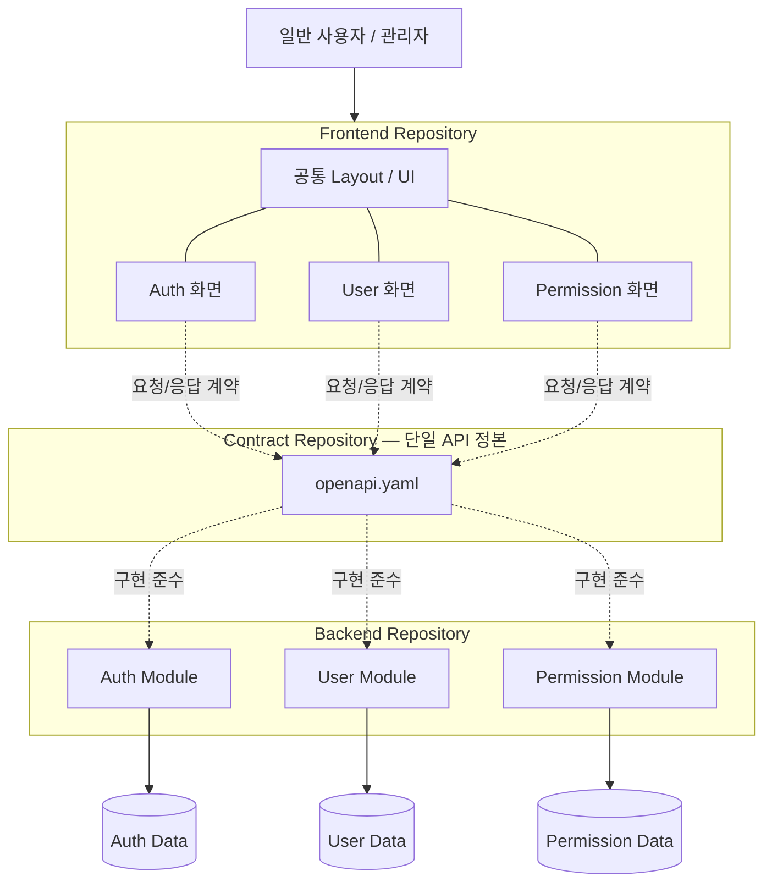

# 시스템 아키텍처 및 책임 경계 (AA 초안)

- **Auth**: 로그인/로그아웃, 비밀번호, 인증·토큰. User 상태/로그인 ID는 User 경계에서 확인합니다.
- **User**: 회원가입, 로그인 ID, 프로필, 관리자 사용자 CRUD, 상태. 가입 시 Auth 자격증명 생성과 Permission 기본 권한 부여가 필요합니다.
- **Permission**: 역할 목록, 사용자 Role 배정, 권한 관리. User 상태/프로필을 직접 수정하지 않습니다.
- **Frontend**: 하나의 공통 앱 + Auth/User/Permission 기능 모듈 + 공통 UI. 화면 모듈 간 연결은 정의된 경로/컴포넌트 인터페이스를 사용합니다.

## 데이터 소유 규칙
- 각 모듈만 자기 소유 데이터를 변경합니다.
- 다른 모듈의 데이터에 접근해야 하면 명시적으로 정의된 서비스 인터페이스를 사용합니다.
- 하나의 물리 DB를 공유할 수 있어도 논리적 데이터 소유권을 구분합니다.
- 실제로 3개 독립 서비스를 배포하려면 **서비스 간 내부 API 계약과 오류/트랜잭션 처리**를 별도로 확정해야 합니다. 현재 openapi.yaml은 FE↔BE 계약입니다.

## 분담 (같은 기능의 FE+BE 수직 개발)
- A: Auth Backend + Auth Frontend
- B: User Backend + User Frontend
- C: Permission Backend + Permission Frontend

이 PoC의 목적은 교차 배정이 아니라 **같은 담당자가 구현하더라도 공통 계약과 설계 경계를 지키며 통합 가능한지 검증**하는 것입니다.

## PoC 구현 형태 제안 (확정 전)

[AA 기술 스택 제안](./aa/tech-stack-proposal.md)에서는 공용 DB 서버가 없는 3인 실험을 위해 **하나의 Spring Boot 실행 앱(논리 Auth/User/Permission 모듈) + 개발자별 H2 Embedded File DB + 단일 React App**을 추천합니다. 모듈은 독립 서비스라는 뜻이 아니며, 데이터 소유 경계와 외부 OpenAPI는 기존 정본을 유지합니다. 실제 채택 여부는 DEC-003/011 승인 후 확정합니다.
