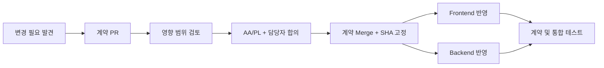

# OpenAPI 계약 변경 및 승인

## 계약 관리 규칙
- 이 저장소의 `openapi.yaml`이 유일한 API 정본입니다. 각 구현 저장소에 수동 복제하여 따로 수정하지 않습니다.
- AA/PL이 최초 기능·경계·1차 계약을 조율합니다. 도메인 담당자가 변경 제안과 구현을 수행합니다.
- **요청/응답 스키마, URL, 상태 코드, 인증 규칙** 변경은 이 저장소에 PR을 먼저 제출합니다.
- 계약 PR에는 변경 이유, 관련 요구 ID, 영향을 받는 FE/BE 화면·서비스, 호환성 영향, 테스트 계획을 적습니다.
- 승인에는 **해당 도메인 FE/BE 담당자와 AA/PL** 검토가 필요합니다. 현재 같은 사람이 FE/BE를 함께 맡으므로 계약 자기승인은 피하고 AA/PL 또는 다른 팀원 1명이 추가 검토합니다.
- 승인된 계약 커밋 SHA를 각 구현 PR에 명시합니다.

## 변경 흐름

## 변경 제안 양식
- 요구사항 ID:
- 대상 API:
- 현재 문제:
- 변경 전/후:
- 영향 화면 / 서비스 / 테스트:
- Breaking Change 여부:
- 반영할 계약 SHA:

## 검증 포인트
1. OpenAPI 명세 파싱·검증
2. FE 요청 타입/필드와 명세 일치 여부
3. BE 응답 구조/HTTP 상태와 명세 일치 여부
4. 권한·오류·페이징·중복 처리 통합 테스트

**참고:** 현재처럼 같은 담당자가 FE/BE를 구현하면 교차 개발 독립성은 직접 검증되지 않습니다. 계약 준수 자동화와 PR 증거로 공통 계약의 실효성을 검증합니다.
