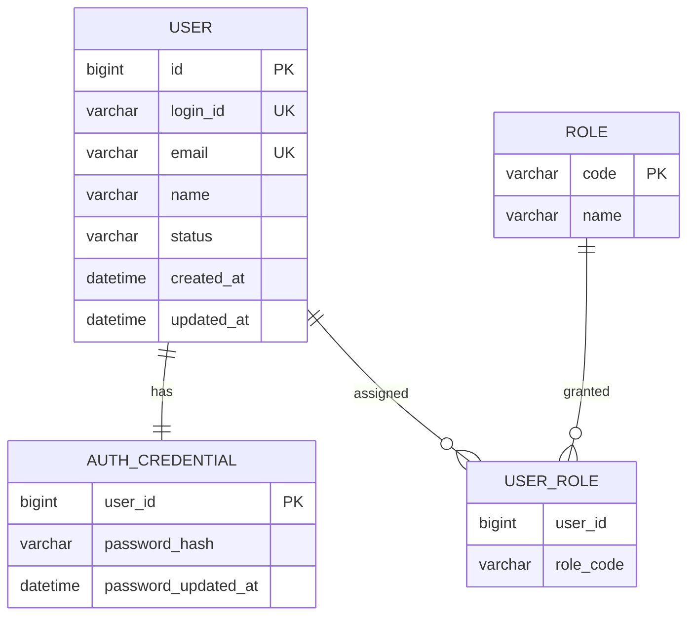

# DB 데이터 모델 / 논리 스키마 (AA 초안)

기술 스택과 DBMS에 독립적인 논리 모델입니다. 실제 DDL은 구현 단계에서 결정합니다.

| Entity | 소유 모듈 | 필수 제약 / 정책 |
|---|---|---|
| USER | User | id PK, login_id UNIQUE, email UNIQUE, status=ACTIVE/INACTIVE/WITHDRAWN, Soft Delete |
| AUTH_CREDENTIAL | Auth | user_id 논리 참조, 비밀번호는 해시로만 보관 |
| ROLE | Permission | code PK, 초기 USER/ADMIN |
| USER_ROLE | Permission | (user_id, role_code) 복합 유니크, 사용자 권한 매핑 |

### 비즈니스 규칙
- 회원가입 완료 시 USER와 AUTH_CREDENTIAL, 기본 USER 역할이 정합성을 가져야 합니다.
- 실제 DB 분리 시 위 ERD의 다른 경계 간 관계는 **논리 참조**입니다. 물리적 외래키를 전제로 하지 않습니다.
- WITHDRAWN은 상태 전환입니다. 데이터 보존/마스킹 정책은 구현 전에 결정해야 합니다.
- 이메일 및 로그인 ID 중복 검사 정책을 정하고 동시성에서도 UNIQUE 제약으로 보장합니다.

### 개발자가 구체화할 항목
DBMS 선택, VARCHAR 길이, 정규화 최적화, 세부 인덱스, 마이그레이션, JPA/SQL 매핑은 구현 설계의 책임입니다. AA 변경 검토 대상은 Entity 책임/Key/핵심 필드/정합성 규칙 변경입니다.
