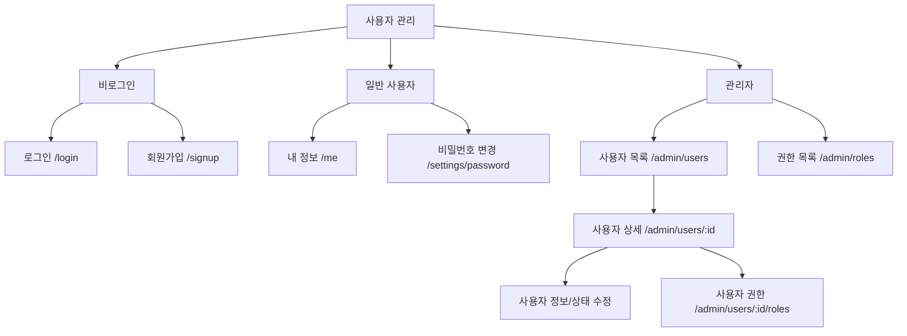

# 화면 IA / 화면 기능 정의 (AA 초안)

## IA


| 화면 ID | 화면/route | 담당자 | 주요 UI/행위 | 참조 API |
|---|---|---|---|---|
| UI-AUTH-001 | 로그인 `/login` | A | ID, 비밀번호, 로그인, 오류 | POST /auth/login |
| UI-AUTH-002 | 비밀번호 변경 `/settings/password` | A | 기존/신규 암호, 검증, 완료 | POST /auth/password/change |
| UI-USER-001 | 회원가입 `/signup` | B | ID/이메일/이름/암호, 중복 오류 | POST /users/signup |
| UI-USER-002 | 내 정보 `/me` | B | 정보 조회/수정 | GET/PATCH /users/me |
| UI-USER-003 | 관리자 사용자 목록 `/admin/users` | B | 검색, 상태 필터, Table, Pagination, 등록 | GET/POST /admin/users |
| UI-USER-004 | 관리자 사용자 상세 `/admin/users/:id` | B | 상세, 정보 수정, 상태 변경, 권한 화면 이동 | GET/PATCH /admin/users/{id}, PATCH /admin/users/{id}/status |
| UI-PERM-001 | 역할 목록 `/admin/roles` | C | Role 목록 | GET /admin/roles |
| UI-PERM-002 | 사용자 권한 `/admin/users/:id/roles` | C | Role 조회/선택/저장 | GET/PUT /admin/users/{id}/roles |

## 화면 패턴
- 인증 화면: 입력 폼 + 필드별 검증 + 오류 메시지
- 관리자 목록: 검색/필터 + 표 + 페이징 + 상세 이동
- 상세: 식별/상태 정보 + 수정 + 다른 기능으로 이동
- 수정: 저장/취소 + 변경 확인
- 공통 상태: loading, empty, error, success, forbidden

### 사용자 목록의 간단한 Wireframe
```text
[공통 헤더 / 사이드 메뉴]
사용자 관리                       [사용자 등록]
[이름/이메일 검색            ][상태▼][검색]
------------------------------------------------
로그인 ID | 이름 | 이메일 | 상태 | 가입일
------------------------------------------------
(사용자 행 클릭 → 상세)
                  [<] 1 2 3 [>]
```

### 연결 원칙
화면/메뉴/행동은 이 문서 기준, API 데이터 교환은 openapi.yaml 기준입니다. 상세 CSS와 화면 구현은 Frontend 담당자가 맡습니다.
